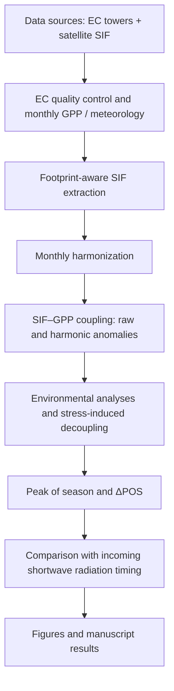

# 🌍 Global SIF–GPP Coupling and Phenological Offsets Across Eddy-Covariance Towers

Analysis code for a footprint-aware, multi-product comparison of satellite solar-induced chlorophyll fluorescence (SIF) with eddy-covariance (EC) gross primary productivity (GPP) at 73 towers. Four SIF products (GOSIF, GOME-2, TROPOSIF, OCO-3) are matched to monthly wind-informed EC source areas, and the repository covers coupling, environmental modulation, stress-related disagreement, aridity, and seasonal peak timing (ΔPOS).

> **Status:** code accompanying a manuscript in preparation. Raw third-party data are **not** included; see [Data availability](#-data-availability).

## 🌱 Overview

**SIF** is a faint light signal emitted by chlorophyll during photosynthesis and measured from space. **GPP** is the rate at which ecosystems fix carbon, measured at EC towers. Because SIF and GPP share a common driver (absorbed light), they correlate strongly over the seasonal cycle, but that agreement does not by itself show they are synchronous or regulated in the same way.

This study asks, using 19,775 site-month observations at 73 towers:

* How strongly are SIF and GPP coupled in raw data versus after removing each tower's seasonal cycle?
* How does coupling vary among towers, biomes, seasons and hemispheres, and are environmental variables (VPD, soil moisture, air temperature, incoming shortwave radiation) associated with that variation?
* Where and when do the two signals disagree, and how does this relate to aridity?
* Do SIF and GPP reach their seasonal peaks at the same time, and how does each relate to the timing of incoming shortwave radiation?

All reported relationships are **associational**; no causal inference is made from correlations, partial correlations, interaction models or pathway models.

## 🔬 Study framework



Details: [docs/workflow.md](docs/workflow.md).

## 🛰️ Satellite SIF products

| Product | Role in this study | Period used (per manuscript) |
|---|---|---|
| **GOSIF** | Spatially continuous product derived from OCO-2 SIF, MODIS and reanalysis data; used as provided (no project-level gap filling). | 2001–2024 |
| **GOME-2 SIF (v2, MetOp-A)** | Daily orbital retrievals (`Daily_Averaged_SIF`), footprint-overlap weighted. | Feb 2007–Jan 2018 |
| **TROPOSIF** | Sentinel-5P TROPOMI retrievals (`SIF_Corr_743`); observed values only. A reconstruction was tested but **not retained**. | May 2018–Dec 2021 |
| **OCO-3 SIF Lite** | ISS-based retrievals (`Daily_SIF_740nm`) with irregular sampling; complete-coverage months retained plus validated reconstructions of positive partial-coverage months. Zero-coverage months were not reconstructed. | Aug 2019–Dec 2025 |

The products differ in retrieval, resolution, record length and tower coverage, so cross-product results are complementary evidence, **not** a controlled ranking of sensor performance. OCO-2 and GOSAT are not part of the final four-product analysis.

## 📡 Eddy-covariance observations

GPP (`GPP_DT_VUT_REF`, daytime partitioning) and meteorological variables (VPD, air temperature, `SW_IN_F`, soil water content, wind direction) come from FLUXNET-standardized records and additional records from regional networks (AmeriFlux, ICOS, OzFlux). `SW_IN_F` is incoming shortwave radiation, used as a **radiation proxy** — not PAR or APAR.

## 🧭 Footprint-aware matching

SIF is matched to each tower with a **custom monthly wind-direction-informed source-area approximation**:

* daytime wind directions are grouped into 10° sectors;
* sector weights are the relative frequency of each sector in that month;
* satellite SIF observations are weighted by their overlap with the resulting source area.

This is a simplified, wind-informed source-area representation. It is **not** a full micrometeorological footprint model and does not use atmospheric stability, friction velocity, roughness length or boundary-layer height.

## 📊 Main analyses

* Raw SIF–GPP coupling (Pearson, Spearman)
* Harmonic-residual (deseasonalized) anomaly coupling
* Biome, seasonal and hemispheric analyses
* Environmental modulation: partial Spearman correlation and interaction models (VPD, soil moisture, air temperature, incoming shortwave radiation)
* Stress-induced SIF–GPP decoupling (SID)
* Aridity analysis
* Seasonal peak of season and phenological offset (ΔPOS)
* Comparison of SIF and GPP peak timing with incoming shortwave radiation
* OCO-3 partial-coverage reconstruction and its validation; sensitivity checks

## 📁 Repository structure

```text
.
├── README.md  LICENSE  CITATION.cff
├── environment.yml  requirements.txt  .gitignore
├── config/                     example path configuration (paths.example.env)
├── scripts/
│   ├── 01_ec_preprocessing/            EC GPP, wind-direction histograms, monthly input tables
│   ├── 02_footprint_sif_extraction/    monthly footprint rasters, footprint-aware SIF, per-product finalization
│   ├── 03_oco3_reconstruction/         OCO-3 partial-coverage reconstruction (+ TROPOSIF test, not retained)
│   ├── 04_coupling/                    harmonic deseasonalization, partial Spearman, interaction & pathway models
│   ├── 05_stress_induced_decoupling/   SID construction and validation
│   ├── 06_phenology_peak_timing/       POS, ΔPOS, radiation-timing analysis
│   ├── 07_figures/                     manuscript figure scripts
│   ├── 08_lst_extension/               land surface temperature extraction and statistics
│   └── 09_sensitivity/                 supporting sensitivity / QA checks
├── docs/                       workflow, data availability, reproducibility, script-name mapping
├── data/                       README only (no data committed)
├── figures/  outputs/          README only (generated files are git-ignored)
```

## 🚀 Reproducing the analysis

The full raw-data workflow is **not one-click reproducible**; see [docs/reproducibility.md](docs/reproducibility.md) for the honest list of gaps.

1. **Clone** the repository.
2. **Create the environment:** `conda env create -f environment.yml` (or `pip install -r requirements.txt`). Python 3.13 was used.
3. **Download the public data** listed in [docs/data_availability.md](docs/data_availability.md), accepting each provider's terms.
4. **Configure paths:** set `SIF_GPP_ROOT` (and optionally `SIF_GPP_DATA_ROOT`, `NE_BASEMAP_TIF`) as in [config/paths.example.env](config/paths.example.env).
5. **Run the scripts in order** (`01_…` → `09_…`; order and prerequisites in the reproducibility document), e.g.:
   ```bash
   export SIF_GPP_ROOT=/path/to/working/root
   python scripts/04_coupling/01_harmonic_deseasonalization_and_core_statistics.py
   ```
6. **Generate figures** with the scripts in `scripts/07_figures/`; the manuscript-figure-to-script table is in the reproducibility document.

## 📦 Data availability

All input datasets are public but are not redistributed here. See [docs/data_availability.md](docs/data_availability.md) and [data/README.md](data/README.md).

## 📜 License

Code and documentation are released under the [MIT License](LICENSE). Third-party datasets keep their original licenses and terms; this repository does not relicense FLUXNET, satellite products or any other provider dataset.

## 📖 Citation

See [CITATION.cff](CITATION.cff). A paper DOI will be added when available.

## 👤 Author / Contact

Aria Ahmadi (University of Tehran) — see the manuscript for the full author list. Please open a GitHub issue for questions about the code.
