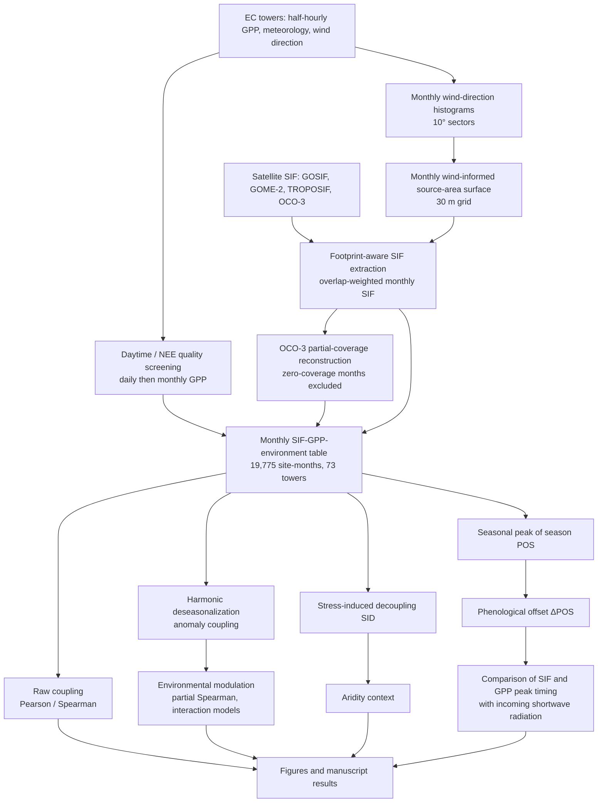

# 🔬 Workflow

This document gives the high-level framework of the study and shows where each step is implemented. Terminology follows the manuscript. All relationships reported are **associational**; none of the correlations, partial correlations, interaction models or pathway models establish causality.

## Stage by stage

| # | Stage | What happens | Code |
|---|---|---|---|
| 1 | **EC preprocessing** | Half-hourly records restricted to daytime and conservative-quality NEE; daily GPP only with ≥ 5 valid half-hourly values; monthly GPP is the mean of valid daily means; months with < 10 valid days or < 100 qualifying records are flagged. Environmental variables are monthly means; SWC is not imputed. | `scripts/01_ec_preprocessing/` |
| 2 | **Footprint-aware matching** | Daytime wind directions are grouped into 10° sectors; relative frequency gives sector weights; sectors extend upwind to a site-specific distance from metadata; weighted sectors are rasterized on a 30 m grid. **This is a simplified, wind-informed source-area approximation, not a micrometeorological footprint model** (no stability, friction velocity, roughness length or boundary-layer height). A same-radius circular buffer is kept only as a comparison. | `scripts/01_ec_preprocessing/` (wind histograms, input tables), `scripts/02_footprint_sif_extraction/` (footprint rasters, SIF extraction) |
| 3 | **SIF extraction / harmonization** | Native satellite observations (GOME-2, TROPOSIF, OCO-3) or grid cells (GOSIF) are intersected with the source area and weighted by source-area probability to give monthly footprint-weighted SIF. Each product is analysed within its own valid period. GOSIF is an upstream reconstructed product and was **not** gap-filled here; GOME-2 and TROPOSIF were not gap-filled. | `scripts/02_footprint_sif_extraction/` |
| 4 | **OCO-3 partial-coverage reconstruction** | Coverage is split into complete, positive-partial and zero coverage. Only positive partial-coverage months were eligible; zero-coverage months were not reconstructed. A Random Forest was selected after comparison with other candidates using artificial gaps and grouped / site-held-out / temporal / spatio-temporal validation. **Tower GPP was not a predictor.** A TROPOSIF reconstruction was tested but not retained. | `scripts/03_oco3_reconstruction/` (+ `troposif_tested_not_retained/`) |
| 5 | **Coupling** | Raw coupling (Pearson, Spearman). Per-tower first- and second-order harmonic regression gives seasonal fits and anomalies (≥ 24 observations over ≥ 8 calendar months). Group estimates require ≥ 12 site-months from ≥ 3 towers. | `scripts/04_coupling/01_*`, `scripts/07_figures/` |
| 6 | **Environmental modulation** | Partial Spearman (rank → residualize → correlate) with tower-block bootstrap; per-tower-standardized interaction models with site effects and tower-clustered standard errors; pooled pathway models. Drivers: VPD, SWC, air temperature, `SW_IN_F` (radiation proxy; LST in the extended maps). | `scripts/04_coupling/advanced_coupling/`, `scripts/04_coupling/environmental_modulation/` |
| 7 | **Stress-induced decoupling (SID)** | Per-product 1st/99th percentile scaling of SIF and GPP; decoupling = \|SIF_norm − GPP_norm\| / max(SIF_norm + GPP_norm, ε); multiplied by separate VPD, soil-moisture and temperature stress scores. | `scripts/05_stress_induced_decoupling/` |
| 8 | **Aridity** | Tower-level Aridity Index (v3.1) compared with SID and with site-level coupling; treated as climatological context, not a monthly forcing. | `scripts/07_figures/fig13_*`, `figS8_*` |
| 9 | **Peak timing / ΔPOS** | POS from fitted harmonic curves at sub-month resolution; climatological POS per tower–product (year-block bootstrap) and year-specific POS (delete-one-month jackknife); ΔPOS = POS_SIF − POS_GPP computed circularly on a ±6-month range (negative = SIF peaks earlier than GPP; as defined in the code, `pos_lib.py`). | `scripts/06_phenology_peak_timing/` |
| 10 | **Radiation comparison** | SIF and GPP peak offsets are compared with the peak of incoming shortwave radiation (`SW_IN_F`, a radiation proxy; not PAR/APAR). The analysis does not use direct APAR, canopy chlorophyll, LAI, FPAR, NIRv or NPQ measurements; mechanisms in these terms are discussed from the literature only. | `scripts/06_phenology_peak_timing/year_specific_mechanism/` |
| 11 | **Figures** | Manuscript figure scripts. | `scripts/07_figures/` |

## Important interpretive notes

* The four SIF products differ in retrieval strategy, footprint, record length and tower coverage. Product comparisons are **not** a controlled ranking of sensor performance.
* OCO-2 and GOSAT are **not** part of the final four-product analysis. Some upstream processing scripts retain code paths for them because the processing archive covered more products; the analysis scripts filter to the four final products.
* Land surface temperature (MODIS MYD21C1) was available for 36 of 73 towers in the project's LST extension, with day/night composition and QA unverified; LST results should be read accordingly.
